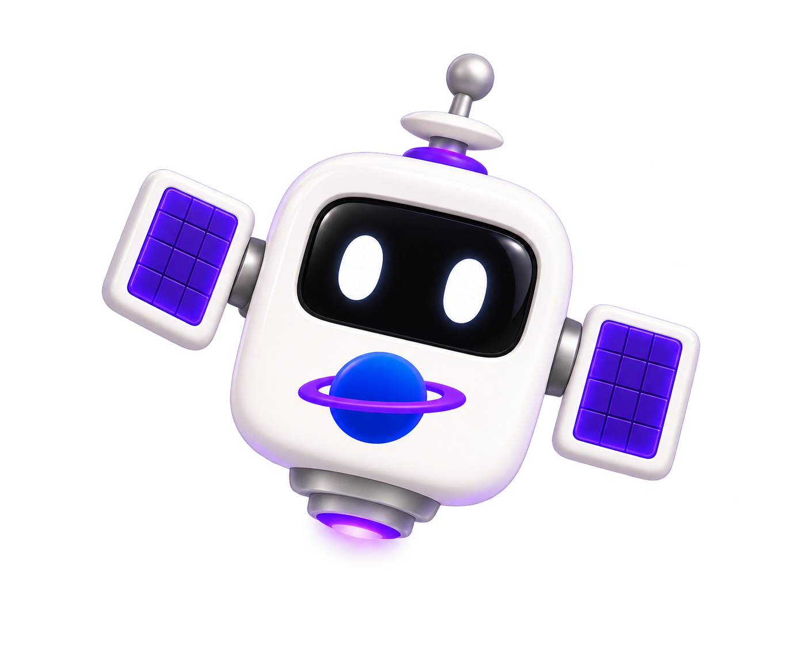

  

  <a href="#por-que-o-astro">O ASTRO</a> ·
  <a href="#o-que-estamos-construindo">Plataforma</a> ·
  <a href="#conheça-o-astrinho">Mascote</a> ·
  <a href="#tecnologias">Tecnologias</a> ·
  <a href="#equipe">Equipe</a> ·
  <a href="https://github.com/Astro-Inter/.github/blob/main/README.md">Guia de desenvolvimento</a>

  <strong>Conformidade em órbita.</strong> 
  Gestão de NRs, conformidades e rotinas de SST para RH, Gestores e Colaboradores.

  

## Por que o ASTRO

Informações de conformidade costumam ficar espalhadas por planilhas, documentos e sistemas diferentes. Isso dificulta acompanhar prazos, identificar pendências e manter uma visão confiável das obrigações.

O **ASTRO** é uma plataforma SaaS em desenvolvimento para centralizar a gestão de conformidade com **Normas Regulamentadoras (NRs)** e os processos operacionais de **Segurança e Saúde no Trabalho (SST)**. O objetivo é reduzir o trabalho manual de RH, profissionais de SST e Gestores, reunindo a estrutura da empresa, as obrigações dos Colaboradores, as atividades e os registros em um único ambiente.

Cada empresa organiza seu **Workspace**, com Colaboradores, Cargos, Unidades e permissões de acesso. Os Cargos definem as obrigações individuais de NR; as Unidades dão contexto às inspeções e verificações operacionais.

## O que estamos construindo

| Frente | Como o ASTRO ajuda |
| --- | --- |
| **Empresa e Colaboradores** | Organiza o Workspace, os Cargos, as Unidades, os cadastros e os papéis de acesso. |
| **NRs e Conformidades** | Acompanha obrigações por Cargo, validades, situação atual e histórico de cada Colaborador. |
| **Eventos e evidências** | Reúne treinamentos, cursos e reciclagens em Turmas, com participantes, conclusões, validação e evidências. |
| **Registros e certificados** | Centraliza registros de conclusão e validade, com lançamento manual ou importação por planilha. |
| **Formulários e inspeções** | Apoia checklists e verificações por Unidade, com respostas de Gestores pelo Mobile e registro de localização. |
| **Comunicação e acompanhamento** | Prevê Chat entre Gestores e Colaboradores, alertas, Notificações e indicadores de conformidade e operação. |
| **Apoio com IA** | Auxilia na análise de NRs e em cálculos; o chatbot permite consultar Conformidades e pendências dentro das permissões de cada pessoa. |

### Web e Mobile

- **Web para Gestores:** configuração do Workspace, gestão de Colaboradores, Cargos, Unidades, NRs e Conformidades, criação de Eventos e Formulários e acompanhamento por indicadores.
- **Mobile para Colaboradores:** consulta de Eventos, NRs e Conformidades, envio de evidências e conclusão de atividades quando permitido, além de Chat e chatbot.
- **Mobile para Gestores:** funções de Colaborador e recursos adicionais, como validar conclusões dos Eventos que criou, consultar a equipe e responder Formulários de inspeção.

> O escopo acima segue o [memorial funcional reunido no astro-knowledge](https://github.com/Astro-Inter/astro-knowledge/blob/main/docs/astro/README.md). Ele descreve o produto planejado; a disponibilidade de cada funcionalidade depende da evolução das aplicações.

O ASTRO organiza, acompanha, calcula, registra e sugere. A responsabilidade legal permanece com a empresa e os profissionais habilitados. O chatbot consulta apenas informações autorizadas e não altera dados nem valida conclusões.

## Conheça o Astrinho

<table>
  <tr>
    <td width="42%" align="center">
      
    </td>
    <td width="58%">
      <h3>Seu copiloto na jornada de conformidade</h3>
      
O <strong>Astrinho</strong> traduz a personalidade do ASTRO: tecnologia próxima, orientação clara e curiosidade para explorar informações complexas.

    </td>
  </tr>
</table>

## Tecnologias

O projeto combina diferentes tecnologias conforme a necessidade de cada componente. As instruções de instalação e as decisões de arquitetura ficam em seus respectivos repositórios.

| Área | Tecnologias utilizadas |
| --- | --- |
| Web | React, TypeScript, JavaScript, HTML e CSS |
| Serviços | Python, FastAPI, Java e Spring Boot |
| Dados | PostgreSQL, MongoDB, Redis e Neo4j |
| Inteligência artificial | Gemini, Groq, LangChain, LangGraph e LangSmith |
| Mobile | Android |
| Desenvolvimento e gestão | Docker, GitHub, Figma e Jira |

## Equipe

<table align="center">
  <tr>
    <td align="center" width="50%">
      <a href="https://github.com/Lipe-to"> <strong>Felipe Battalhini Boregio</strong></a> 
      Mobile · @Lipe-to
    </td>
    <td align="center" width="50%">
      <a href="https://github.com/rosamaduda"> <strong>Maria Eduarda Araujo Gonçalves Rosa</strong></a> 
      Back-end · @rosamaduda
    </td>
  </tr>
  <tr>
    <td align="center">
      <a href="https://github.com/IgorQuinto5"> <strong>Igor Quinto</strong></a> 
      Front-end · @IgorQuinto5
    </td>
    <td align="center">
      <a href="https://github.com/Taina14m"> <strong>Tainá Dias Martinelli</strong></a> 
      Front-end · @Taina14m
    </td>
  </tr>
  <tr>
    <td align="center">
      <a href="https://github.com/lucaslimaoliveira"> <strong>Lucas Lima De Oliveira</strong></a> 
      Dados · @lucaslimaoliveira
    </td>
    <td align="center">
      <a href="https://github.com/LuizaDeVicente"> <strong>Luiza Cursino De Vicente</strong></a> 
      Dados · @LuizaDeVicente
    </td>
  </tr>
</table>

## Desenvolvimento

Quer contribuir? O [guia de desenvolvimento](https://github.com/Astro-Inter/.github/blob/main/README.md) reúne a organização do trabalho no Jira, os padrões de Git e os modelos usados nas entregas. Para instalar ou contribuir em um componente, consulte também o README do repositório correspondente.

## Licença

O projeto está em desenvolvimento. A licença ainda não foi definida.
